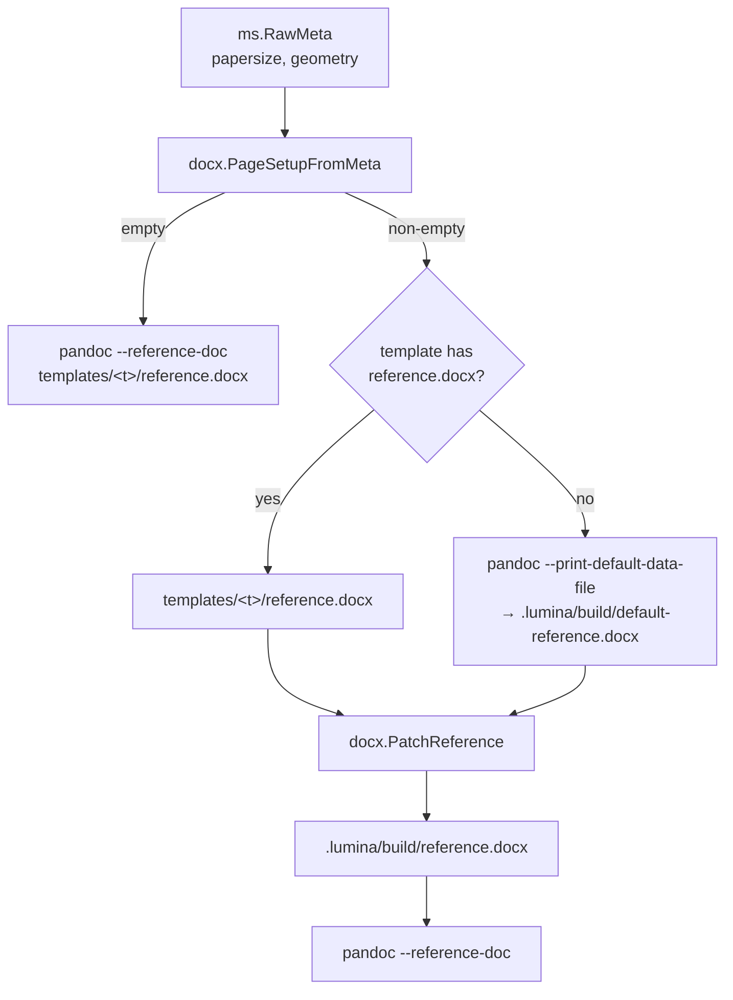

# SDD Spec: DOCX Page Setup from Metadata

## Metadata

* **Status:** `IMPLEMENTING`
* **Author:** Claude (agent), for Konstantin Sharlaimov
* **Created:** 2026-10-26
* **Last Updated:** 2026-10-26
* **Approver:** Konstantin Sharlaimov (approved direct implementation on 2026-10-26)

---

## Phase 1: Proposal (Rough Idea)

### 1.1 Problem Statement

Paper size and margins of the PDF are controlled from `metadata.yaml`
(`papersize`, `geometry`), which pandoc forwards to LaTeX. Pandoc ignores
both keys for DOCX output: page size and margins come verbatim from the
reference document (`templates/<template>/reference.docx`). A manuscript
that switches from A4 to Letter, or changes margins, therefore gets a PDF
and a DOCX with different layouts, and the only fix is to hand-edit the
reference document, which is shared by every target using that template.

### 1.2 Proposed Solution

At DOCX build time, derive a page setup (paper size, orientation, four
margins) from `papersize` and `geometry` in the target metadata. When the
metadata requests anything, copy the reference document into
`.lumina/build/reference.docx`, rewrite its final section properties
(`w:pgSz`, `w:pgMar`) and pass the patched copy to pandoc. Keys absent
from metadata keep the reference document's values. The template's
`reference.docx` then carries fonts and styles only, and one
`metadata.yaml` controls page layout for both PDF and DOCX.

### 1.3 Scope & Requirements

* **In Scope:**
  * `papersize`: `a4`, `a5`, `b5`, `letter`, `legal`, `executive`
    (case-insensitive, optional `paper` suffix, as in LaTeX class options).
  * `geometry` (string or list of strings, as pandoc accepts):
    * margins: `margin`, `hmargin`, `vmargin` (one value or `{a,b}`),
      `left`/`lmargin`/`inner`, `right`/`rmargin`/`outer`,
      `top`/`tmargin`, `bottom`/`bmargin`;
    * paper: bare `<name>paper`, `paper=`/`papername=`, `paperwidth`,
      `paperheight`, `papersize={w,h}`;
    * orientation: `landscape`, `portrait`.
  * Units: `pt` (TeX point), `bp`, `pc`, `mm`, `cm`, `in`.
  * Geometry keys that do not affect the page box (e.g. `includefoot`,
    `showframe`) are skipped with a warning naming the key; malformed
    values of supported keys and unsupported units are build errors.
  * Right-aligned tab stops in `TOC1`–`TOC9` styles that sit on the old
    right margin move to the new right margin.
  * When the template has no `reference.docx` but page setup is
    requested, pandoc's default reference document is used as the base.
  * Unit tests for parsing and patching; README documentation.
* **Out of Scope:**
  * Headers/footers, columns, line numbering, gutter/binding offset,
    two-sided (`twoside`) layouts, `includehead`/`includefoot` maths.
  * Section-level page setup (only the document's final `w:sectPr` is
    patched; pandoc emits a single section).
  * Font size (`fontsize`) and line spacing (`linestretch`) in DOCX:
    these remain the reference document's concern.
  * Page breaks before specific headings (known DOCX limitation).

---

## Phase 2: System Design (SDD)

### 2.1 Architecture & Components

A new package `internal/docx` holds pure functions (no runner calls).
`cmd/build/docx.go` wires them in before invoking pandoc.



The patch runs on every DOCX build (it is cheap), so it never goes stale
relative to `metadata.yaml` or the template, independent of preprocess
caching.

### 2.2 Data Structures & Interfaces

```go
// PageSetup holds page geometry in twips (1/1440 in). Nil fields keep the
// reference document's value.
type PageSetup struct {
    Width, Height            *int
    Top, Right, Bottom, Left *int
    Landscape                *bool
}

func (p PageSetup) IsZero() bool

// PageSetupFromMeta reads papersize and geometry from pandoc metadata.
// Returned warnings name geometry keys that were skipped.
func PageSetupFromMeta(meta map[string]any) (PageSetup, []string, error)

// ParseLength converts a TeX length ("2cm", "1in", "72.27pt") to twips.
func ParseLength(s string) (int, error)

// PatchReference copies the reference document src to dst, applying p to
// the final section properties and realigning TOC right tab stops.
func PatchReference(src, dst string, p PageSetup) error
```

Invariants: lengths are non-negative integers in twips; paper width and
height are positive. `geometry` overrides `papersize`; within `geometry`
later options override earlier ones (same as the LaTeX package).
`landscape` makes the width the larger dimension and sets
`w:orient="landscape"`.

XML handling: OOXML parts are rewritten textually around the `w:` prefix
pandoc uses. Existing attributes on `w:pgSz`/`w:pgMar` (`w:header`,
`w:footer`, `w:gutter`) are preserved. A missing `w:pgMar` is created with
Word's defaults (1in margins, 0.5in header/footer) for unspecified sides.
New elements are inserted in schema order (`pgSz` before `pgMar`, both
before `cols`, `docGrid`, etc.). Other zip entries are copied unchanged.

### 2.3 Protocol / API Changes

* No new config keys or CLI flags. `papersize` and `geometry` gain
  meaning for `build --docx`.
* New intermediate files: `.lumina/build/reference.docx` and, if needed,
  `.lumina/build/default-reference.docx`.

### 2.4 Real-Time & Resource Impacts

One zip read/write of a ~50 KB file per DOCX build; negligible next to the
pandoc run. One extra pandoc call only when the template lacks a
reference document and page setup is requested.

---

## Phase 3: Implementation Plan (IP)

### 3.1 Task Breakdown

- [x] **Task 1:** Length and metadata parsing
  - **Files:** `internal/docx/doc.go`, `internal/docx/pagesetup.go`,
    `internal/docx/pagesetup_test.go`
  - **Verification:** `go test ./internal/docx/...`
- [x] **Task 2:** Reference document patching
  - **Files:** `internal/docx/reference.go`, `internal/docx/reference_test.go`
  - **Verification:** `go test ./internal/docx/...`
- [x] **Task 3:** Wire into DOCX build (incl. default reference fallback)
  - **Files:** `cmd/build/docx.go`
  - **Verification:** `go build ./... && go vet ./...`
- [x] **Task 4:** Documentation
  - **Files:** `README.md`, `spec/README.md`, `AGENTS.md`
  - **Verification:** review
- [x] **Task 5:** End-to-end check on a real project
  - **Verification:** `make test`, `make build`, then
    `_build/lumina build <target> --docx` with `papersize: letter` and
    inspect `word/document.xml` in the output.

### 3.2 Risks & Mitigation

* **Malformed reference documents** (non-`w:` prefix, multiple sections):
  patch the last `w:sectPr` only; fail with a clear error if none exists.
* **Geometry options lumina doesn't understand silently diverging from the
  PDF:** emit a warning per skipped key.
* **Docker runner paths:** the default-reference fallback runs pandoc with
  the build directory as cwd and a relative output name, which both
  runners map correctly.

---

## Phase 4: Execution & Verification

- [x] All per-task verification steps pass.
- [x] Linter / vet clean.
- [x] Unit tests pass.
- [x] Build targets compile.
- [x] Neighbor packages unaffected.
- [ ] Approved by the User.

---

### 4.1 Execution Log

* `internal/docx`: `PageSetupFromMeta`, `ParseLength`, `PatchReference`
  with unit tests (paper names, braced values, option precedence,
  warnings, errors; empty/full/multi-section `w:sectPr`, landscape,
  schema order, TOC tab realignment, untouched parts).
* `cmd/build/docx.go`: `pageSetupReference` stages
  `.lumina/build/reference.docx`; tested with a fake runner, including
  the pandoc default-reference fallback.
* End-to-end on `academic_markdown/co4007_unit7_assessment` (template
  reference document is Letter): `papersize: a4` + geometry produced A4
  with 2cm/1.5cm margins and moved the TOC2 tab from 9972 to 9638 twips;
  `papersize: letter` produced Letter; `geometry` list with `landscape`
  and `showframe` produced landscape Letter and a warning for
  `showframe`.

---

## Phase 5: Completed

- [ ] All Phase 4 items `[x]`.
- [ ] No regressions.
- [ ] Spec document reflects actual implementation.
- [ ] `spec/README.md` updated to `COMPLETED`.
- [ ] Approved by the User.
