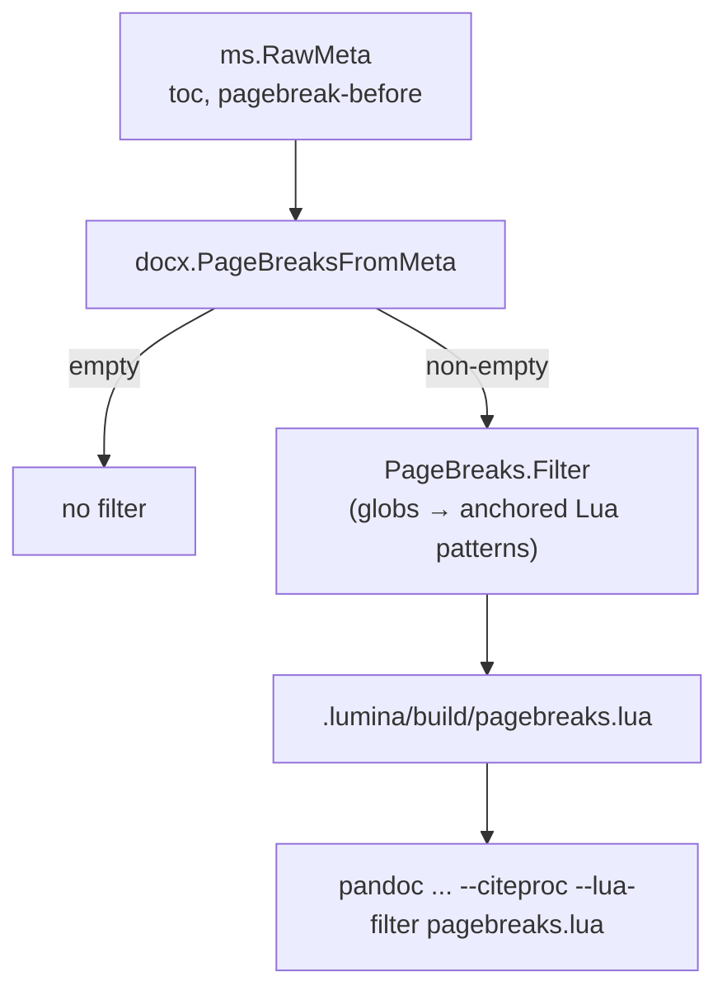

# SDD Spec: DOCX Page Breaks from Metadata

## Metadata

* **Status:** `COMPLETED`
* **Author:** Claude (agent), for Konstantin Sharlaimov
* **Created:** 2026-10-26
* **Last Updated:** 2026-10-26
* **Approver:** Konstantin Sharlaimov (chose the metadata-pattern design on 2026-10-26)

---

## Phase 1: Proposal (Rough Idea)

### 1.1 Problem Statement

The LaTeX template starts the body, the appendices and the reference list
on new pages (`\clearpage`). The DOCX writer has no such mechanism: the
reference document can only give a paragraph style `pageBreakBefore`, and
pandoc uses the same `Heading1` style for every top-level heading. DOCX
output therefore runs the body straight on from the table of contents and
the appendices on from the last section. Putting raw `openxml` blocks in
the manuscript works but clutters the source with format-specific markup.

### 1.2 Proposed Solution

At DOCX build time, generate a pandoc Lua filter from metadata that inserts
an OpenXML page-break paragraph:

* before the first body block when `toc: true` (after the TOC);
* before each top-level heading whose text matches a glob in the new
  `pagebreak-before` metadata key.

The manuscript stays free of markup and each target states its breaks once.

### 1.3 Scope & Requirements

* **In Scope:**
  * `pagebreak-before`: string or list of strings; globs with `*`, `?`
    (one UTF-8 character) and `\` escape; case-sensitive; matched against
    the whole stringified text of level-1 headings in the top-level block
    list.
  * Automatic break before the body when `toc` is `true`.
  * At most one break before a block (a matching first heading with
    `toc: true` gets one break).
  * Malformed `pagebreak-before` values fail the build.
  * Unit tests; a pandoc-backed filter test when pandoc is on the host;
    README documentation.
* **Out of Scope:**
  * PDF/LaTeX output (the template already breaks there).
  * Headings below level 1, headings nested inside divs.
  * Section breaks (`w:sectPr`) or per-section page setup.
  * Suppressing the heading's space-before at the top of the new page.

---

## Phase 2: System Design (SDD)

### 2.1 Architecture & Components



The filter is regenerated on every DOCX build. Pandoc runs with
`.lumina/build/` as working directory, so the filter is passed by its
relative name, which works for both host and Docker runners.

### 2.2 Data Structures & Interfaces

```go
type PageBreaks struct {
    AfterTOC bool     // from toc
    Before   []string // globs from pagebreak-before
}

func (b PageBreaks) IsZero() bool
func PageBreaksFromMeta(meta map[string]any) (PageBreaks, error)
func (b PageBreaks) Filter() (string, error) // Lua filter source
```

Globs are translated in Go into anchored Lua patterns with magic
characters escaped, and embedded with all control and non-ASCII bytes as
decimal escapes. The filter acts only when `FORMAT == "docx"` and runs
after `pandoc-acro`, `pandoc-crossref` and citeproc.

The break is an empty paragraph with `w:pageBreakBefore`, zero spacing and
an exact 1pt line height, so it adds no visible blank line.

### 2.3 Protocol / API Changes

* New metadata key `pagebreak-before` (forwarded to pandoc; ignored by the
  LaTeX template).
* `toc: true` now also implies a page break before the DOCX body.
* New intermediate file `.lumina/build/pagebreaks.lua`.

### 2.4 Real-Time & Resource Impacts

One small file write per DOCX build; the filter is a single pass over the
top-level blocks.

---

## Phase 3: Implementation Plan (IP)

### 3.1 Task Breakdown

- [x] **Task 1:** Metadata parsing and filter generation
  - **Files:** `internal/docx/pagebreaks.go`, `internal/docx/pagebreaks_test.go`
  - **Verification:** `go test ./internal/docx/...`
- [x] **Task 2:** Wire into DOCX build
  - **Files:** `cmd/build/docx.go`, `cmd/build/docx_test.go`
  - **Verification:** `go build ./... && go vet ./...`
- [x] **Task 3:** Documentation
  - **Files:** `README.md`, `AGENTS.md`, `spec/README.md`, `internal/docx/doc.go`
  - **Verification:** review
- [x] **Task 4:** End-to-end check on a real project
  - **Verification:** `make build`, `_build/lumina build <target> --docx`,
    render with LibreOffice and check the page each heading starts on.

### 3.2 Risks & Mitigation

* **Lua pattern semantics differ from globs:** translation is tested in Go
  and the generated filter is run through host pandoc in a unit test
  (skipped without pandoc).
* **Heading text changed by earlier filters** (e.g. crossref numbering):
  the filter runs last, and pandoc's own section numbering in DOCX is not
  part of the heading text.

---

## Phase 4: Execution & Verification

- [x] All per-task verification steps pass.
- [x] Linter / vet clean.
- [x] Unit tests pass.
- [x] Build targets compile.
- [x] Neighbor packages unaffected.
- [x] Approved by the User.

---

### 4.1 Execution Log

* `internal/docx/pagebreaks.go`: `PageBreaksFromMeta`, `Filter`, glob and
  Lua-string helpers; tests cover parsing, errors, escaping, and a pandoc
  run checking break placement (incl. non-ASCII `?` and nested headings).
* `cmd/build/docx.go`: `pageBreaksFilter` writes the filter and adds
  `--lua-filter`.
* End-to-end on `academic_markdown/co4007_unit7_assessment` (Docker
  runner) with `toc: true` and `pagebreak-before: ["Appendix*",
  "References"]`: four breaks; LibreOffice rendering puts Contents on p3,
  the body on p4, Appendix A on p16, Appendix B on p17 and References on
  p18.
* `lumina init` metadata template lists every supported key (optional
  ones commented out); a scaffold test checks the key set and that the
  commented examples parse as valid page setup and page breaks.

---

## Phase 5: Completed

- [x] All Phase 4 items `[x]`.
- [x] No regressions.
- [x] Spec document reflects actual implementation.
- [x] `spec/README.md` updated to `COMPLETED`.
- [x] Approved by the User.
